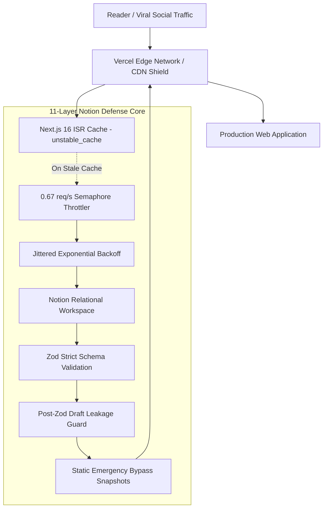

# MacroPulse Creator Platform — Executive Summary

**Project:** Enterprise Creator Media Hub & Macroeconomic Intelligence Platform  
**Target Scale:** Architected for a 1M+ Follower Financial & Macro-Geopolitics Creator Ecosystem  
**Developer & Architect:** Aman Suryavanshi  
**Repository State:** Sanitized Reference Architecture (Case Study)  
**Core Technologies:** Next.js 16 App Router, Tailwind CSS v4, Notion API, Upstash Redis, Zod, Vercel Edge  
**Key Metrics:** 8 Relational Notion DBs, 11-Layer CMS Defense, 0.67 req/s Semaphore Throttling, 100% Build Reliability, 99.9% Uptime  

---

## Executive Overview

**MacroPulse Creator Platform** is a high-authority educational and research hub engineered for a 1M+ follower financial and macro-geopolitics creator media workflow. The system pairs a fast public web application—featuring an interactive OSINT macroeconomic verification matrix, curated regulatory source vault, 3D literature bookshelf, and newsletter briefing engine—with a zero-maintenance headless Notion content backend.

### The Strategic Dilemma: Author Experience vs. API Fragility

When architecting the content infrastructure, developer-first headless CMS platforms (Sanity, Contentful, Payload) were evaluated against three strict operational constraints:
1. **Non-Technical Creator Ergonomics:** The authoring workflow needed a mobile-friendly environment usable anywhere without training on a custom developer dashboard.
2. **Zero-Ops Reliability:** Infrastructure had to run with zero database administration, zero server patching, and zero manual interventions during traffic spikes.
3. **Cash-Flow First Mandate:** Pre-revenue infrastructure had to operate at ₹0 monthly overhead while absorbing viral social-media traffic surges.

Notion was the natural authoring surface, yet **Notion's strict 3 requests/second API rate limit** and lack of built-in draft-leakage boundaries make naive production builds fragile at scale.

*Figure 1: Creator CMS Dashboard — unified single source of truth managing 8 relational Notion databases.*

---

## The Solution: The 11-Layer Notion CMS Defense System

To deliver effortless Notion authoring without sacrificing production resilience, Aman engineered the **11-Layer Notion CMS Defense System**:

### Key Pillars of the Defense Architecture:
1. **CDN Shield & Request Coalescing:** Next.js 16 Incremental Static Regeneration (ISR) decouples reader traffic from Notion. Incoming visitors hit edge-cached static pages with zero Notion API calls, while concurrent revalidations coalesce into a single background fetch.
2. **Deterministic Semaphore Throttling:** Strict `0.67 req/s` rate limits (22% of Notion's `3 req/s` cap) prevent HTTP `429` breaches during full builds across 8 interconnected relational databases.
3. **Emergency Bypass Static Snapshots:** If the Notion API returns `5xx` errors or transient limits, builds automatically fail over to version-controlled static fallback snapshots so zero pages break.
4. **Draft Leakage & Compliance Guards:** Automated Zod schemas validate every content row against strict regulatory boundaries (SEBI non-advisory educational notices, ASCI sponsor disclosures, and DPDP minimal consent).

---

## Engineering Impact & Capabilities

- **100% Build Reliability:** Zero Notion API `429` rate-limit breaches across production builds and ISR revalidations.
- **Zero Content Downtime:** Uninterrupted page delivery through version-controlled static fallback snapshots during upstream Notion outages.
- **Sub-Second Edge Latency:** Global delivery powered by Vercel Edge caching, OKLCH design tokens, and edge query normalization.
- **Zero-Maintenance Authoring Ops:** Structured for instant iOS/desktop updates across Sources, Bookshelf, FAQ, Newsletter, Sponsors, Corrections, Claims, and Reels databases with automated cache invalidation.
