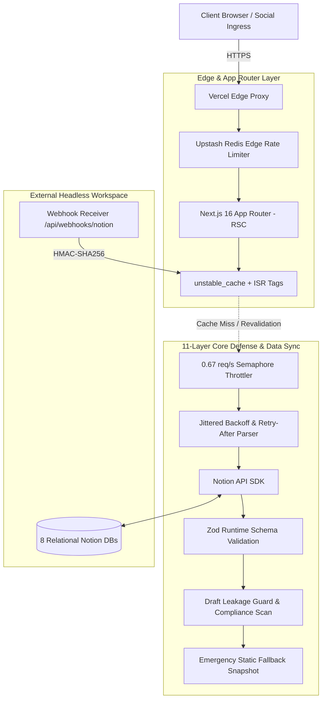

# MacroPulse Creator Platform — Technical Architecture Documentation

**System:** Enterprise Creator Media Hub & OSINT Verification Platform (1M+ Follower Creator Scale)  
**Architect:** Aman Suryavanshi  
**Stack:** Next.js 16 (App Router), React 19, Tailwind CSS v4, Notion SDK, Upstash Redis, Zod v3, Vercel Edge  
**Repository State:** Sanitized Reference Architecture  

---

## 1. System Architecture Overview

The **MacroPulse Creator Platform** is architected around a **static-first, headless CMS integration model** engineered to absorb viral social-media traffic spikes without exceeding third-party API rate quotas.

---

## 2. The 8 Relational Notion Databases

The creator authoring workflow is partitioned across 8 tightly-coupled relational databases within a unified Notion workspace:

| Database | Primary Key | Relations | Purpose |
| :--- | :--- | :--- | :--- |
| **Sources** | `Slug` (Text) | `Reels`, `Claims` | Primary regulatory filings, research reports, and verified citations. |
| **Bookshelf** | `BookID` (Text) | `Sources` | Curated library with custom CSS spine rendering, affiliate links, and book summaries. |
| **FAQ** | `QuestionID` (Text) | `Sources` | Educational FAQ system with SEBI-compliant non-advisory disclaimers. |
| **Newsletter** | `IssueID` (Number) | `Sources`, `Sponsors` | Published editorial newsletters distributed to subscribers via Beehiiv sync. |
| **Sponsors** | `PartnerID` (Text) | `Newsletter` | ASCI-compliant partner disclosures and campaign sponsorship logs. |
| **Corrections** | `CorrectionID` (Text) | `Reels`, `Sources` | Public transparent correction ledger demonstrating editorial integrity. |
| **Claims** | `ClaimID` (Text) | `Sources`, `Reels` | Atomic verifiable factual claims extracted from video scripts. |
| **Reels** | `VideoID` (Text) | `Sources`, `Claims` | Short-form video metadata, timestamped transcripts, and citation mappings. |

### Relational Architecture & Workspaces

The headless content backend exposes a clean, mobile-friendly authoring workspace directly in Notion, consumed headlessly by Next.js 16 via ISR:

*Figure 2.1: Creator CMS Dashboard providing unified relational access across Sources, Bookshelf, FAQ, Newsletter, Sponsors, and Reels Verifier.*

|  |  |
| :---: | :---: |
| *Figure 2.2: Relational Sources Database with IMF, RBI, and SEBI regulatory tracking.* | *Figure 2.3: Relational Bookshelf Database with real-time Published/Draft lifecycle flags.* |

---

## 3. The 11-Layer Core Notion Defense

To guarantee zero rate-limiting crashes (Notion's 3 req/s threshold) and prevent draft exposure, the following 11 defense layers are enforced:

### Layer 1: Proactive Semaphore Throttling
- Integrates a custom async semaphore wrapping the `@notionhq/client`.
- Limits outgoing requests to **0.67 req/s** (guaranteeing utilization remains below 22% of Notion's 3 req/s quota).
- Normalizes incoming query keys in middleware via `NextResponse.rewrite` to prevent CDN cache-fragmentation attacks.

### Layer 2: Reactive Jittered Exponential Backoff
- Traps HTTP 429, 502, 503, 504, and 529 responses.
- Implements AWS-style full-jitter backoff:
  $$\text{Sleep} = \text{random}(0, \, \min(M, \, B \cdot 2^{\text{attempt}}))$$
- Employs a dual-format header parser compatible with both Unix epoch timestamps and delta-second offsets in `Retry-After`.

### Layer 3: Degraded Emergency Bypass Snapshots
- Flag: `NOTION_BYPASS_ON_BUILD_FAILURE=true`.
- In the event of catastrophic third-party Notion downtime, builds automatically fail over to version-controlled JSON snapshots stored under `src/data/fallback/`.
- Every snapshot is strictly validated against the corresponding Zod schema before emission.

### Layer 4: Content Integrity & Draft Leakage Guard
- Queries enforce `filter: { property: "Status", select: { equals: "Published" } }`.
- Post-fetch Zod parser validates that `isDraft !== true`.
- Automated regex audit verifies the absence of internal editorial notes or unreleased draft content.

### Layer 5: Observability & ISR Freshness Probes
- Dedicated health check endpoint: `/api/health/isr-freshness`.
- Returns HTTP 200 with JSON telemetry detailing cache hit rates, database staleness timestamps, and fallback status.
- Triggers alerts if any cached route exceeds $2\times$ its expected TTL.

### Layer 6: Content-Loss Prevention (Minimum Row Assertions)
- Guard assertions enforce minimum expected row counts per database:
  - `Sources >= 5`, `Bookshelf >= 3`, `FAQ >= 2`, `Newsletter >= 2`, `Sponsors >= 2`, `Corrections >= 1`.
- Prevents accidental deletion of entire datasets due to faulty Notion API filter queries.

### Layer 7: Preview Deployment Environment Isolation
- `NOTION_API_KEY` is isolated to the production deployment environment.
- Branch previews and PR deploys compile exclusively against static fallback snapshots, preventing staging pipelines from exhausting production API quotas.

### Layer 8: Compliance & Stale Snapshot Safeguards
- Fallback snapshots carry an immutable `snapshot_date`.
- Git pre-commit hooks warn if fallback data exceeds 90 days of age.

### Layer 9: Automated AI Crawler Coherence
- Webhook notifications from Notion trigger automated revalidations of `/llms.txt` and `/sitemap.xml`.
- Guarantees that AI search engines (Perplexity, ChatGPT, Claude) always ingest fresh, synchronized content entity graphs.

### Layer 10: Edge-Request Budget Optimization
- Middleware uses internal URL rewrites instead of HTTP 308 redirects to normalize tracking parameters.
- Reduces billable Edge Request counts by 50% during viral social media spikes.

### Layer 11: Multi-Tier Cache Persistence
- Leverages Next.js `unstable_cache` with tagged cache invalidation (`revalidateTag('notion')`).
- File-system backed caching survives serverless container restarts and server cold starts.

---

## 4. Edge Security & Compliance Directives

1. **SEBI Non-Advisory Compliance:** Educational disclaimer components are embedded statically into the layout root, verified by automated DOM assertions during build time.
2. **ASCI Sponsorship Guardrails:** Every commercial sponsor mentioned in newsletter issues dynamically pulls verified disclosure tags from the Sponsors relational database.
3. **DPDP Minimal Consent:** Newsletter subscriber forms collect only email addresses with explicit opt-in checkboxes, backed by server-side Zod email sanitization.
